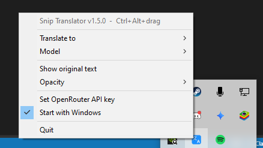

# Snip Translator

Translate any text on your screen. Hold **Ctrl+Alt**, drag a box over the text, and the translation appears right in that box. It works on chats, games, images, videos — anything you can see.

## Install

1. Go to [Releases](../../releases/latest) and download `SnipTranslator-Setup-x.x.x.exe`.
2. Run it. If Windows shows "Windows protected your PC", click **More info → Run anyway** (the app isn't code-signed yet).
3. Snip Translator starts in your system tray (bottom-right, next to the clock — click the **^** arrow if you don't see it).

## Get an API key (one-time setup)

Snip Translator uses [OpenRouter](https://openrouter.ai) to read and translate text. You need your own key — it takes about 2 minutes.

1. Sign up at **[openrouter.ai](https://openrouter.ai)**.
2. Add a few dollars at **[openrouter.ai/credits](https://openrouter.ai/credits)**. Translations cost a fraction of a cent each, so $5 lasts a very long time.
3. Go to **[openrouter.ai/keys](https://openrouter.ai/keys)**, click **Create API Key**, and copy it (it starts with `sk-or-`).
4. Right-click the Snip Translator icon in your tray and choose **Set OpenRouter API key**.

   

5. Paste your key and click **OK**. Done!

> Your key is saved only on your computer (`%LOCALAPPDATA%\SnipTranslator\settings.json`). Never share it.

## Use

| Do this | To |
|---|---|
| **Ctrl+Alt + drag** | Translate a region of the screen |
| **Ctrl+Alt + click** a box | Close it |
| Buttons on a box | Copy the translation, retry, or close |

Right-click the tray icon to change the **target language**, **model**, **opacity**, whether the **original text** is shown, and whether it **starts with Windows**.

## Troubleshooting

- **"No OpenRouter API key"** — do the API key steps above.
- **"Rejected the API key"** — the key was copied wrong or deleted; make a new one and set it again.
- **"Credits are empty"** — top up at [openrouter.ai/credits](https://openrouter.ai/credits).
